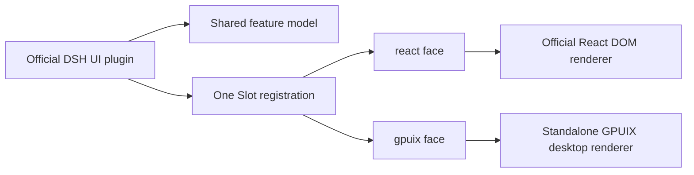

# GPUIX renderer-face architecture

Status: design proposal

## Decision summary

MyGO does not introduce a second product UI, a presentation plugin, a generic native widget
framework or a parallel Slot tree. Each official DSH UI plugin remains the owner of its feature and
may register renderer-specific faces on one logical Slot contribution:

- `react`: the existing React DOM implementation;
- `gpuix`: the same official contribution implemented for `@gpuix/react`.

Both faces keep the same Slot name, registration options, props, feature model, services, actions,
navigation meaning, permissions, lifecycle, localization and accessibility intent. The face is
chosen only at the rendering seam.



This map does not assume a generic `native` face. No maintained general React-to-Compose renderer
exists to justify a shared GPUIX/Compose component contract. Creating the reconciler, bridge,
component registry, layout and event system would recreate the central complexity of React Native.
A future renderer may extend the face registry after its concrete authoring and runtime model is
chosen.

## Ownership

The official feature package owns its faces. For example, the official Settings plugin owns the
Settings Slot registration, controller, React view and GPUIX view. MyGO does not replace that
ownership with an application-wide presentation plugin.

The normal implementation shape is:

```tsx
const model = createOfficialFeatureModel(ctx)

ctx.slots.register(options, faces({
  react: props => <ReactView {...props} model={model} />,
  gpuix: props => <GpuixView {...props} model={model} />,
}))
```

If a component is independent of DOM elements, browser APIs and CSS layout, both faces may share
its renderer-neutral model, hooks or component source. A DOM-specific view gets a sibling GPUIX
view. Shared code stops where renderer semantics diverge; MyGO does not invent a cross-platform
control abstraction merely to share more files.

This is a source-organization rule, not two runtime plugin entries. The Loader, Cordis scope and
Slot ledger still contain one feature contribution.

## Required alignment

The two faces remain aligned in observable product behavior:

- identical Slot key, kind, cell, priority, ordering and child declarations;
- identical feature state, controllers, stores, Remote calls and resource permissions;
- identical commands, mutations, validation and error meaning;
- identical navigation destinations and back behavior;
- identical labels, locale keys and accessibility intent;
- identical activation, disposal and shared failure ownership.

Physical layout, controls and animation may differ where GPUIX requires them. Those differences
must not change the feature model or add a capability absent from the official UI.

## Slot face extension

### Registration

`ui-slots` gains an extensible, branded face declaration while preserving the old registration
form. The exact type spelling may follow existing declaration-merging conventions, but it must
retain this shape:

```ts
interface SlotFaceRegistry {
  react: ReactNode
  gpuix: ReactNode
}

type FaceId = keyof SlotFaceRegistry

declare const slotFaces: unique symbol

type SlotFaces<P> = {
  readonly [slotFaces]: true
} & Partial<Record<FaceId, SlotComponent<P>>>

function faces<P>(value: Omit<SlotFaces<P>, typeof slotFaces>): SlotFaces<P>

register<P>(options: RegisterOptions<P>, component: SlotComponent<P>): Entry
register<P>(options: RegisterOptions<P>, components: SlotFaces<P>): Entry
```

The old second argument remains exactly equivalent to `{ react: component }`. The branded wrapper
prevents an arbitrary object from being mistaken for a face table. Both current faces return
`ReactNode`; the GPUIX face uses the real `@gpuix/react` reconciler rather than a JSON UI protocol.

### Election

Face eligibility is applied before the original Slot election:

1. select entries that provide the renderer's requested face;
2. apply the existing `single`, `keyed`, `list`, `chain` or `hoc` rules;
3. render the winning face with the original props and Slot host.

This prevents a high-priority React-only entry from shadowing a lower-priority GPUIX entry.
Priority, keys and ordering otherwise retain their official meaning.

The Slot ledger, stores, child declarations, subscriptions, chains and HOCs remain shared. A view
failure is reported against its face and occurrence. A model, service, registration or Cordis
lifecycle failure remains attached to the shared contribution.

### Renderer selection

The existing DOM renderer requests `react`. The GPUIX renderer requests `gpuix`. A renderer never
changes registration identity or invents another Slot key.

## GPUIX primitives

GPUIX controls are a renderer-specific UI library, not a generic native component framework. They
may use `@gpuix/react`, GPUI Kit and GPUIX types directly. Official `gpuix` faces may import this
library because their renderer identity is explicit.

Shared official prop types, controllers, theme semantics and feature models may remain in existing
packages. A separate primitive abstraction is justified only where it hides meaningful GPUIX
implementation complexity from many feature packages; it must not proxy every host element or
pretend to be a future Compose interface.

Alma is the visual-quality reference for GPUIX controls and the Settings surface: spacing,
typography, density, interaction states, materials and motion. It does not provide MyGO features,
navigation or information architecture. The official DSH Settings sections, fields, mutations,
validation, labels and locale keys remain unchanged.

## Standalone desktop runtime

The GPUIX application owns the operating-system window, event loop and GPU drawing surface on
Linux, Windows and macOS. The Cordis client tree, Loader, Remote services and GPUIX React root run
with the desktop application's JavaScript runtime. There is no DOM root, Electron shell or
always-running Chromium application surface.

GPUIX packages must be pinned as one compatible set because the project is pre-1.0. Bun versus Node,
binary packaging and update policy remain decisions in the runtime-packaging ticket.

## Existing plugins and Web compatibility

An existing plugin using the old component form remains React-only without source changes. The
standalone desktop application may mount it in an explicit, isolated Web compatibility surface.
That surface is a bounded child or helper process, never the application shell.

MyGO does not translate arbitrary DOM components into GPUIX controls and does not silently omit a
required contribution. Native-first versus Web fallback preference is an explicit presentation
policy decided by the Web-compatibility ticket.

## DSH source delta

The required client-rendering changes are:

1. `ui-slots`: branded extensible faces, face-aware eligibility and face-local diagnostics;
2. existing `ui-renderer`: request `react` while preserving current DOM behavior;
3. GPUIX renderer package: request `gpuix`, own the `@gpuix/react` root and bind the OS window;
4. GPUIX theme, control and rich-content libraries;
5. official `ui-*` feature packages: add their `gpuix` face and extract shared models only where
   the existing view is DOM-specific;
6. tests: prove election, lifecycle and behavioral parity.

Cordis, Loader, Remote, Host services, server protocol and feature authority do not change.

## Implementation sequence

### G1 — Face-aware Slot core

- add the branded, extensible face declaration;
- retain source compatibility for existing React registrations;
- filter by requested face before election;
- verify every Slot kind, error path and disposal path.

### G2 — GPUIX desktop foundation

- create the standalone GPUIX application and renderer plugin;
- implement official theme semantics, typography, input, focus, scrolling and accessibility;
- establish the GPUIX control library and GPUI Kit adapters;
- validate Linux, Windows and macOS capability reporting.

### G3 — Official Settings vertical slice

- add `gpuix` faces to official Settings packages;
- preserve exact sections, fields, mutations, validation and i18n behavior;
- use Alma only as the desktop visual-quality reference;
- compare React and GPUIX behavior with the same model fixtures.

### G4 — Official session vertical slice

- add `gpuix` faces package by package for layout, navigation, session, conversation, input,
  messages, tools and approvals;
- preserve original stores, Session services and Remote calls;
- validate streaming, long lists, focus and keyboard behavior.

### G5 — Web compatibility

- host React-only contributions in an explicit Web surface;
- preserve instance authentication, storage and module isolation;
- coordinate navigation and lifecycle through the shared Slot contribution.

### G6 — Complete official plugin coverage

- migrate remaining official packages according to the coverage matrix;
- give every platform-backend package an explicit GPUIX implementation, Web fallback or allowed
  absence under its Slot contract;
- run the full conformance matrix.

Android renderer design is outside this map. It must reuse business services and Slot ownership,
but this decision does not prescribe React Native, Compose or a custom bridge.

## Conformance gates

A migrated official feature is complete only when:

- React and GPUIX resolve the same logical Slot contribution;
- both observe the same model snapshot and perform the same mutations;
- permissions and Remote failures retain the same codes and user meaning;
- activation and disposal leave no face-specific services behind;
- locale and theme changes update both faces from the same official state;
- the GPUIX layout adds no feature or destination absent from the official UI;
- the React face remains behaviorally unchanged.

## Rejected alternatives

- **Central presentation plugin:** creates a second product graph.
- **Generic native face shared by GPUIX and Compose:** requires a new cross-platform component
  contract, renderer, bridge, layout and event system—effectively rebuilding React Native.
- **Alma feature clone:** introduces product behavior absent from the official UI.
- **JSON UI as the feature authoring model:** loses the standard React development model.
- **Automatic DOM-to-GPUIX conversion:** cannot preserve arbitrary browser behavior.
- **Electron or Chromium as the desktop shell:** makes the compatibility runtime the permanent
  application cost and defeats the standalone native renderer goal.

## References

- [Unified Slot rendering](unified-slot-rendering.md)
- [Presentation contract](presentation-contract.md)
- [Platform carrier contract](platform-carrier-contract.md)
